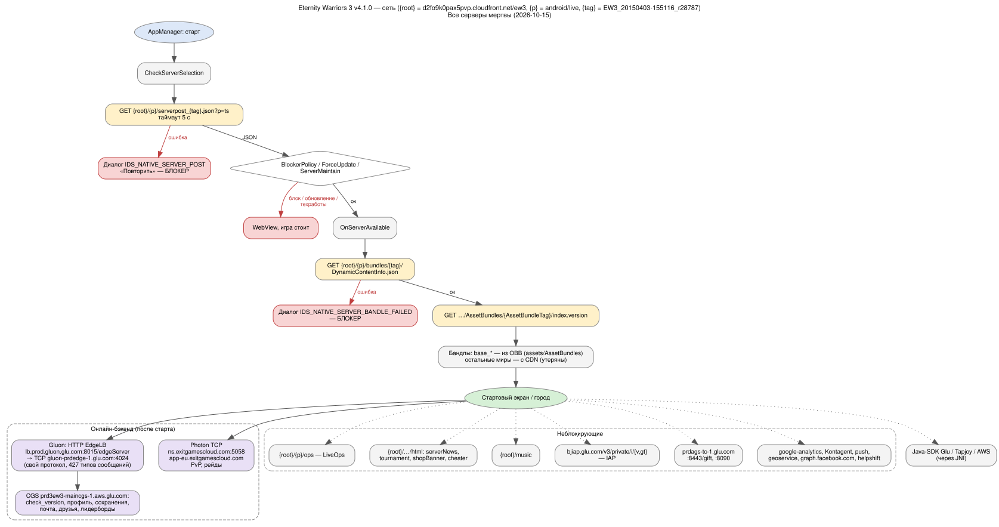

# Eternity Warriors 3 v4.1.0: сетевые маршруты

Источник: декомпиляция `Assembly-CSharp.dll` (`extracted/decompiled/`). Проверено 2026-10-15:
все серверы мертвы (DNS не резолвится, S3-бакет `bjstudio` удалён), в Wayback Machine копий CDN нет.

Подстановки: `{root}` = `http://d2fo9k0pax5pvp.cloudfront.net/ew3` (Global; `GluOnConfig.CloudFront` из serverpost
может его заменить), `{plat}` = `android`, `{cfg}` = `live`, `{tag}` = `EW3_20150403-155116_r28787`
(`BUILD_TAG` из APK).

## Граф

Исходник — [network.dot](network.dot) (`dot -Tsvg docs/network.dot -o docs/network.svg`). Тот же граф в Mermaid:

## Выводы для прототипа

1. **До стартового экрана** нужны только два JSON-ответа: `serverpost_{tag}.json` и `DynamicContentInfo.json`,
   плюс `index.version` (копия из OBB). Это крошечный Python-мок (или IL-патч `DoGetServerPost` /
   `GetDynamicContentInfo` на локальные ответы). Точные поля serverpost — в `EW3DownloadManager.cs:994-1210`.
2. **Gluon** — собственный TCP-протокол Glu (`glu.Gluon`, 427 классов сообщений). Профиль и сохранения
   лежат на сервере (CGS). Эмуляция — отдельный большой этап, сейчас отложена. Для прототипа — IL-патч
   `Gluon.AuthenticatePlayer`/`CGS` на офлайн-ответы, когда до этого дойдём.
3. **Photon** — патч IL (онлайн-режимы отключить), как и планировалось.
4. **Контент**: в OBB только базовые миры (город, деревня, greece_1). Остальные миры качались с CDN и,
   судя по всему, утеряны — играбельна только базовая часть, пока не найдётся источник бандлов.
