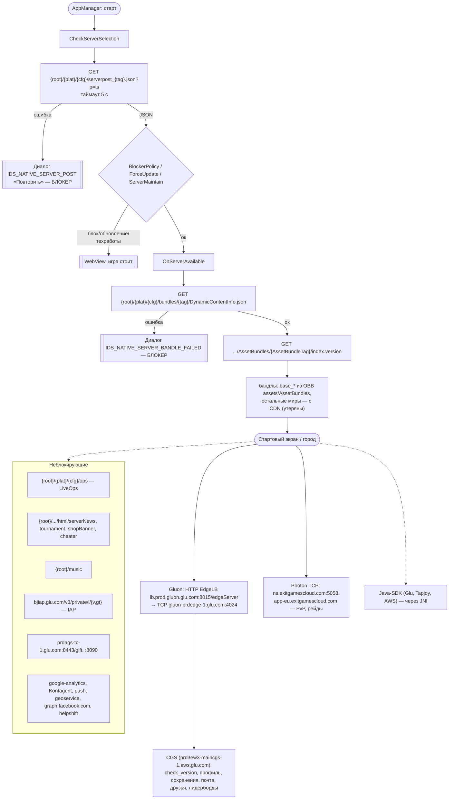

# Eternity Warriors 3 v4.1.0: сетевые маршруты

Источник: декомпиляция `Assembly-CSharp.dll` (`extracted/decompiled/`). Проверено 2026-10-15:
все серверы мертвы (DNS не резолвится, S3-бакет `bjstudio` удалён), в Wayback Machine копий CDN нет.

Подстановки: `{root}` = `http://d2fo9k0pax5pvp.cloudfront.net/ew3` (Global; `GluOnConfig.CloudFront` из serverpost
может его заменить), `{plat}` = `android`, `{cfg}` = `live`, `{tag}` = `EW3_20150403-155116_r28787`
(`BUILD_TAG` из APK).

## Граф

Исходник — [network.dot](network.dot) (`dot -Tsvg docs/network.dot -o docs/network.svg`). Тот же граф в Mermaid:

## Что сделано локально

Все серверы подменяет [server/ew3server.py](../server/ew3server.py) (HTTP `:18080`, Gluon edge `:18024`). Порт
([symtab_net.cpp](../port/src/symtab_net.cpp), [unity_www.cpp](../port/jni/unity_www.cpp)) без `EW3_SERVER` ведёт себя как
телефон в режиме полёта; с `EW3_SERVER=127.0.0.1` любое исходящее соединение идёт на сервер, порты переводятся:

| Гость | Сервер | Что это |
|---|---|---|
| `4024` | `18024` | Gluon edge (TCP + BSON) |
| `8015`, `80` | `18080` | балансировщик (`/edgeServer`), CDN и конфиг по HTTP |
| `443`, Photon (`5055`, `5058`), статистика, реклама | отказ | игра воспринимает это как «нет связи» |

1. **До стартового экрана** нужны `serverpost_{tag}.json`, `DynamicContentInfo.json` и `index.version`: сервер отдаёт их,
   `index.version` пропатчен под восстановленные бандлы ([bundle_patcher.py](../server/bundle_patcher.py)).
2. **Gluon** реализован: [edge.py](../server/edge.py) (кадры `длина | код | номер | BSON`, схема в
   `server/generated/gluon_schema.json`) и игровая логика CGS в `server/cgs*.py`. Запросы без обработчика получают
   пустой `SUCCESS` и пишутся в лог.
3. **Photon** не поднимается: порты отказывают, онлайн-режимы (PvP, рейды) недоступны.
4. **Контент**: в OBB только базовые миры. Пропатченные бандлы сервер кладёт в `bundle_cache/`, игра берёт их оттуда или
   по HTTP (`EW3_BUNDLE_CACHE`). Остальные миры восстанавливаются из iOS-сборки v0.1.0 (`.ipa`) или берутся из готового расширенного пакета `.ew3x` (тот же кэш, собранный заранее). Сервер отдаёт `GET /_ew3/ready` с токеном запуска: по нему приложение отличает новый сервер от прежнего.
5. **Android:** тот же сервер работает на телефоне внутри приложения (Python 3.8 под qemu-arm), см.
   [PORTING_GUIDE.md](PORTING_GUIDE.md#часть-7-android-bridge-apk).

Исторические выводы до реализации (2026-10-15): достаточно было мока из двух JSON, Gluon считался «большим этапом»,
контент миров считался утерянным.
